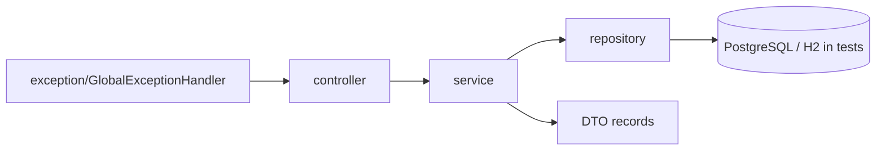

# api-gestao-frota-veiculos

**English** · [Português (Brasil)](README.md)

[](#) [](#) [](#) [](#) [](#) [](LICENSE)

## What it is

REST API for **vehicle fleet management**: vehicle registration, maintenance (open, close, cancel), cost tracking, and a consolidated cost report per vehicle — built on **Java 21 + Spring Boot 3.3.5** with PostgreSQL.

## Status

Working and tested: **40 tests** passing (`mvn test`, BUILD SUCCESS). Academic/portfolio project; PostgreSQL at runtime, H2 in tests.

## Features

- **Vehicles** (`/veiculos`): list, get by id, create, update (`PUT`) and delete; a duplicate plate is rejected with `PlacaDuplicadaException`.
- **Maintenance** (`/manutencoes`): list, get by id, list by vehicle (`/veiculo/{veiculoId}`), open, close (`PATCH /{id}/concluir`), cancel (`PATCH /{id}/cancelar`) and delete.
- **Costs** (`/custos`): list, get by id, list by vehicle (`/veiculo/{veiculoId}`), record and delete.
- **Cost report** (`/relatorios/custos`): consolidates costs per vehicle (`RelatorioCustoResponse` + `RelatorioCustoItem`).
- **Global exception handling** (`GlobalExceptionHandler`): standard `ErroResposta` responses; domain exceptions for missing vehicle/maintenance/cost and business-rule violations.

## Architecture

Classic layered structure: `controller` → `service` → `repository` → JPA entities, with DTO records separating request/response and enums for status and types.



## Stack

- Java 21 · Spring Boot 3.3.5 (web, data-jpa, validation)
- PostgreSQL (runtime) · H2 (tests)
- JUnit 5 / Spring Boot Test

## Repository layout

```
api-gestao-frota-veiculos/
├── pom.xml · BRIEF.md · LICENSE
├── src/main/java/com/kelvinoliveira/gestaofrota/
│   ├── controller/      # Veiculo, Manutencao, Custo, RelatorioCusto
│   ├── service/         # business rules (plate/status validation)
│   ├── repository/      # JPA repositories
│   ├── model/           # entities + enums (StatusVeiculo, StatusManutencao, ...)
│   ├── dto/             # request/response records
│   ├── exception/       # exceptions + GlobalExceptionHandler
│   └── GestaoFrotaApplication.java
├── src/main/resources/application.properties
├── src/test/java/       # 40 tests (controllers + services)
└── src/test/resources/
```

## Prerequisites and installation

Java 21 and Maven. A `gestao_frota` PostgreSQL database (or H2).

```bash
mvn clean install
```

## How to run

```bash
mvn spring-boot:run
# or
java -jar target/api-gestao-frota-veiculos-1.0.0.jar
```

The API runs on port `8080`. Endpoint examples:

- `POST /veiculos` — registers a vehicle (duplicate plate → 409)
- `POST /manutencoes` — opens a maintenance job
- `PATCH /manutencoes/{id}/concluir` — closes a maintenance job
- `GET /relatorios/custos?veiculoId={id}` — cost report for a vehicle

## Tests and quality

Real command (verified by the agent):

```bash
mvn test
# Tests run: 40, Failures: 0, Errors: 0 — BUILD SUCCESS
```

## Technical decisions and trade-offs

- **PostgreSQL at runtime, H2 in tests**: fast tests with no server; in exchange, the PostgreSQL driver only matters when the app starts.
- **DTOs as records**: simple, immutable contracts; in exchange, more classes per domain.
- **Status enums**: enforce transitions (open/close/cancel) with explicit rules in the service.
- **Unique plate**: business rule in the service with its own exception, not in the repository.

## Known limitations and roadmap

- No authentication/authorization (open API).
- `ddl-auto=update` with `show-sql=true`: fine for dev, not for production.
- No pagination on list endpoints.
- No openapi/swagger.

## Development process

An individual project by Kelvin Oliveira, built with orchestrated AI agents and reviewed by the author. The API design and the review are the author's.

## License and author

MIT — Copyright (c) 2026 Kelvin Rebelo de Oliveira.

**Author**: [Kelvin Oliveira](https://github.com/KelvinOliveiraCode) · [Portfolio](https://kelvinoliveiracode.github.io/portfolio/)
