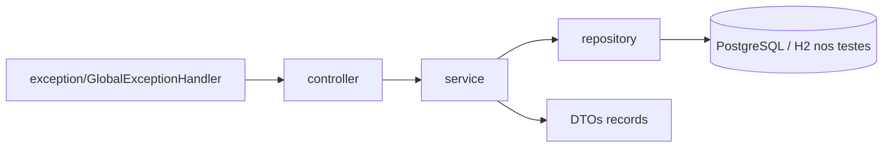

# api-gestao-frota-veiculos

[English](README.en.md) · **Português (Brasil)**

[](#) [](#) [](#) [](#) [](#) [](LICENSE)

## O que é

API REST de **gestão de frota de veículos**: cadastro de veículos, manutenções (abrir, concluir, cancelar), lançamento de custos e relatório de custos consolidado por veículo — em **Java 21 + Spring Boot 3.3.5** com PostgreSQL.

## Status

Funcional e testado: **40 testes** passando (`mvn test`, BUILD SUCCESS). Projeto acadêmico/portfólio; usa PostgreSQL em runtime e H2 nos testes.

## Funcionalidades

- **Veículos** (`/veiculos`): listar, buscar por id, criar, atualizar (`PUT`) e remover; placa duplicada é rejeitada com `PlacaDuplicadaException`.
- **Manutenções** (`/manutencoes`): listar, buscar por id, listar por veículo (`/veiculo/{veiculoId}`), abrir, concluir (`PATCH /{id}/concluir`), cancelar (`PATCH /{id}/cancelar`) e remover.
- **Custos** (`/custos`): listar, buscar por id, listar por veículo (`/veiculo/{veiculoId}`), lançar e remover.
- **Relatório de custos** (`/relatorios/custos`): consolida custos por veículo (`RelatorioCustoResponse` + `RelatorioCustoItem`).
- **Tratamento global de exceções** (`GlobalExceptionHandler`): respostas `ErroResposta` padronizadas; domínios com `VeiculoNaoEncontradoException`, `ManutencaoNaoEncontradaException`, `CustoNaoEncontradoException`, `NegocioException`.

## Arquitetura

Camadas clássicas: `controller` → `service` → `repository` → entidades JPA, com DTOs (records) separando request/response e enums para status e tipos.



## Stack

- Java 21 · Spring Boot 3.3.5 (web, data-jpa, validation)
- PostgreSQL (runtime) · H2 (testes)
- JUnit 5 / Spring Boot Test

## Estrutura do repositório

```
api-gestao-frota-veiculos/
├── pom.xml · BRIEF.md · LICENSE
├── src/main/java/com/kelvinoliveira/gestaofrota/
│   ├── controller/      # Veiculo, Manutencao, Custo, RelatorioCusto
│   ├── service/         # regra de negócio (validação de placa/status)
│   ├── repository/      # JPA repositories
│   ├── model/           # entidades + enums (StatusVeiculo, StatusManutencao, ...)
│   ├── dto/             # records de request/response
│   ├── exception/       # exceções + GlobalExceptionHandler
│   └── GestaoFrotaApplication.java
├── src/main/resources/application.properties
├── src/test/java/       # 40 testes (controllers + services)
└── src/test/resources/
```

## Pré-requisitos e instalação

Java 21 e Maven. Banco PostgreSQL com `gestao_frota` criado (ou use H2).

```bash
mvn clean install
```

## Como executar

```bash
mvn spring-boot:run
# ou
java -jar target/api-gestao-frota-veiculos-1.0.0.jar
```

A API sobe na porta `8080`. Exemplos de endpoints:

- `POST /veiculos` — cadastra veículo (placa duplicada → 409)
- `POST /manutencoes` — abre manutenção
- `PATCH /manutencoes/{id}/concluir` — conclui manutenção
- `GET /relatorios/custos?veiculoId={id}` — relatório de custos por veículo

## Testes e qualidade

Comando real (verificado pelo agente):

```bash
mvn test
# Tests run: 40, Failures: 0, Errors: 0 — BUILD SUCCESS
```

## Decisões técnicas e trade-offs

- **PostgreSQL em runtime, H2 nos testes**: testes rápidos e sem servidor; em troca, o driver PostgreSQL só importa na hora de subir.
- **DTOs como records**: contratos simples e imutáveis; em troca, mais classes por domínio.
- **Enums de status**: validam transições (abrir/concluir/cancelar) com regras explícitas no service.
- **Placa única**: regra de negócio no service com exceção própria, não no repositório.

## Limitações conhecidas e roadmap

- Sem autenticação/autorização (API aberta).
- `ddl-auto=update` com `show-sql=true`: bom para dev, não para produção.
- Sem paginação nos endpoints de listagem.
- Sem openapi/swagger.

## Processo de desenvolvimento

Projeto individual de Kelvin Oliveira, construído com agentes de IA orquestrados e revisado pelo autor. O design da API e a revisão são do autor.

## Licença e autor

MIT — Copyright (c) 2026 Kelvin Rebelo de Oliveira.

**Autor**: [Kelvin Oliveira](https://github.com/KelvinOliveiraCode) · [Portfólio](https://kelvinoliveiracode.github.io/portfolio/)
